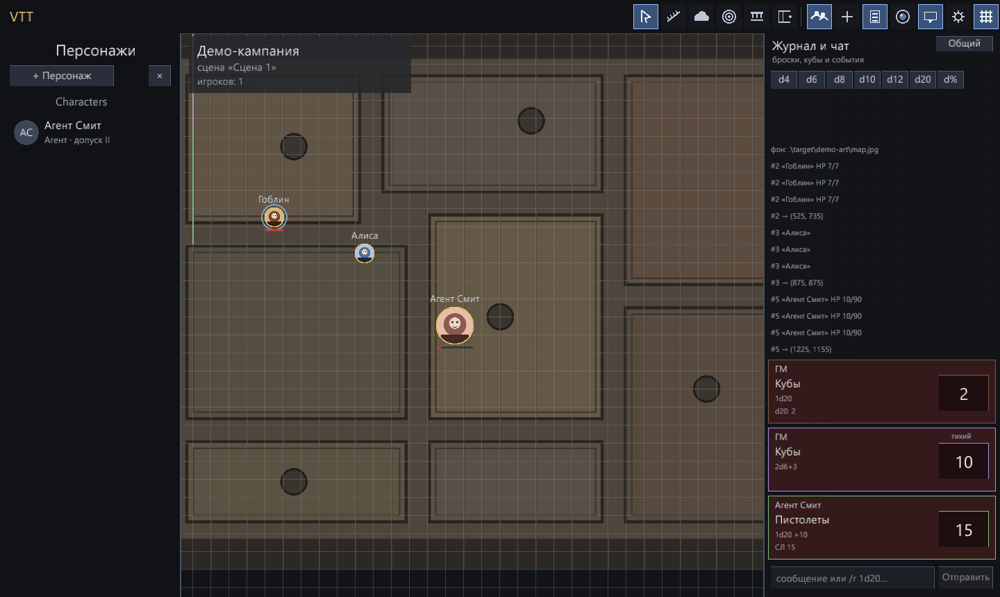
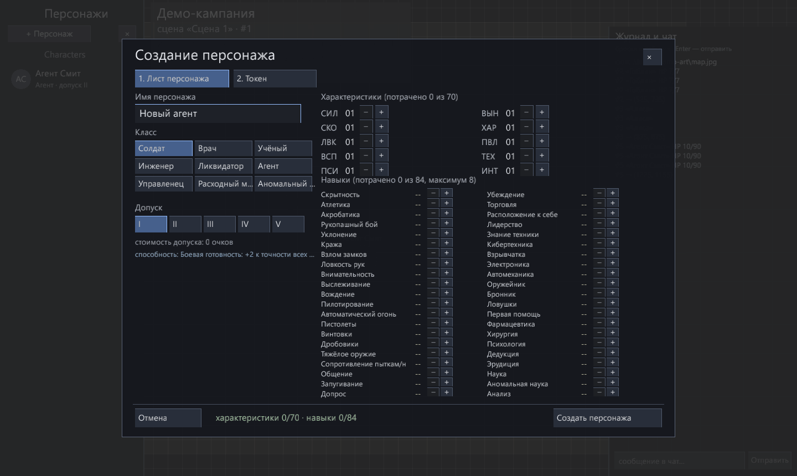
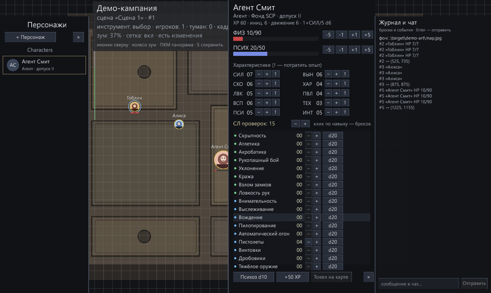

# VTT на Rust — ядро и прототип стола

Виртуальный настольный стол для настольных ролевых игр (в первую очередь D&D 5e / 5.5e),
в котором **сервером работает компьютер ГМа**, а не облако.

> **Статус: v0.5 — комната, чат, роли и адаптивное окно.** Есть модель мира,
> правила, дайсы, авторитарный сервер, сетевые комнаты, консольный клиент и **окно
> ГМа**: карта, стены, туман, мастер создания персонажа, список персонажей, лист SCP,
> круговые токены из картинок (PNG/JPEG/BMP/WebP), чат, роли, настройки комнаты и поля.
> Финальный рендерер на `wgpu` — следующий этап.

*English summary: a Rust VTT where the GM's machine is the authoritative server.
Includes a headless core (rules, dice, protocol, TCP rooms, CLI), a windowed
prototype (map, tokens, walls, fog-of-war) and an interactive SCP character sheet
(10 attributes, 42 skills, 9 classes, psychosis tables). MIT licensed.*

[](https://github.com/luckycleve0-cloud/VVT/actions/workflows/ci.yml)
[](LICENSE)
[Репозиторий](https://github.com/luckycleve0-cloud/VVT)


---

## Что уже работает

### Ядро и сервер

| Возможность | Где |
|---|---|
| Модель мира: сцены, токены, персонажи, эффекты, состояния | `vtt-core` |
| Правила 5e: модификаторы, спасброски, навыки, инициатива, атаки, урон | `vtt-core` |
| Дайсы: `2d6+3`, `4d6kh3`, `2d20kl1`, преимущество/помеха, криты | `vtt-core` |
| Сетка: квадрат/гекс, снап, 5e / 3.5 / линейка | `vtt-core` |
| Стены, двери, окна, линия видимости, ручной туман, шаблоны AoE | `vtt-core` |
| Права: ГМ / со-ГМ / игрок / зритель, владение токеном | `vtt-core` |
| Авторитарный сервер: намерения → проверка → события | `vtt-server` |
| Скрытые токены не попадают игроку **даже в снапшот** | `vtt-server` |
| Компендиум: паки монстров/заклинаний/предметов, поиск | `vtt-core` + `content/` |
| Смерть: спасброски, стабилизация, «мёртв»; отдых; концентрация под уроном | `vtt-server` |
| Хендауты, туман, возврат в игру по `--resume` | `vtt-server` |
| Сохранение/загрузка кампании в JSON + журнал сессии | `vtt-server` |
| Протокол с версией, снапшоты, события, шёпот | `vtt-proto` |
| Комната по TCP: код комнаты, подключение игроков | `vtt-net` |
| CLI: `demo`, `host`, `join`, `info` | `vtt-app` |

### Окно (прототип)

| Возможность | Статус |
|---|---|
| Окно, камера (панорама, зум к курсору) | ✅ |
| Карта картинкой, сетка с отсечением | ✅ |
| Токены: цвет, имя, HP-бар, концентрация, «мёртв», перетаскивание | ✅ |
| Стены и двери: рисование, двери открываются | ✅ |
| Линия видимости, туман по клеткам, «память исследования» | ✅ |
| **Лист персонажа SCP: здоровье, 10 характеристик, 42 навыка** | ✅ |
| **Броски навыков/характеристик, психоз d10, опыт, повышение** | ✅ |
| **Мастер создания персонажа: имя, класс, допуск, очки, токен** | ✅ |
| **Круговые токены из картинок, 4 рамки и 8 цветов** | ✅ |
| **Список персонажей (как Characters в Roll20), «+ Персонаж»** | ✅ |
| **Мультивыделение: Ctrl+клик и рамка, групповое перетаскивание** | ✅ |
| **Размер токена (`[`/`]`), границы карты перетаскиванием края (ГМ)** | ✅ |
| **Размер токена, прозрачность, скрытие — панель по кнопке «Токен»** | ✅ |
| **Чат в окне (GM ↔ игроки), ввод с Enter** | ✅ |
| **Комната ГМа по TCP: код, адрес, список игроков** | ✅ |
| **Роли: ГМ / со-ГМ / игрок / зритель — выдача и кик** | ✅ |
| **Настройки поля: сетка, размер клетки, футы, карта, туман** | ✅ |
| **Верхняя панель с иконками инструментов и окон** | ✅ |
| **Правая панель как в Roll20: карточки бросков и чат** | ✅ |
| **Кубы d4–d20, тихий/общий бросок, /r и /gr, /w** | ✅ |
| **Компактный/полный HUD и его скрытие (настройки → Интерфейс, H)** | ✅ |
| **Адаптивное окно: виртуальный экран 1440×860 + letterbox** | ✅ |
| **Картинки токенов и карт: PNG, JPEG, BMP, WebP** | ✅ |
| egui-панели, журнал-статьи, компендиум в UI, спрайты карты | ⏳ дальше |

Тестов: **199** (`cargo test --workspace`), clippy и rustfmt — чистые.

---


## Готовые сборки (без Rust)

Скачайте ZIP из [Releases](https://github.com/luckycleve0-cloud/VVT/releases):
`VVT-windows-x64.zip` (Windows 10/11 x64). Внутри:

- `1-Play-window.bat` — окно ГМа с демо-картой;
- `2-Host-room.bat` — создать комнату (печатает код и адрес);
- `3-Join-player.bat` — подключиться игроком (спросит адрес, код, имя);
- `4-Demo-check.bat` — проверка без сети.

Rust и консольные команды не нужны: всё через `.bat`-файлы.
## Скачать и проверить подключение

Публичный репозиторий: <https://github.com/luckycleve0-cloud/VVT>

```bash
git clone https://github.com/luckycleve0-cloud/VVT.git
cd VVT
cargo run -p vtt-app -- demo      # проверка правил/сети без окна (проходит все шаги)
cargo test --workspace            # 199 тестов
```

### Проверка сетевой комнаты на одном компьютере

Терминал 1 (ГМ-хост, печатает код комнаты, например `8LTEDX`):

```bash
cargo run -p vtt-app -- host --name "Моя кампания" --dir ./campaign
```

Терминал 2 (игрок; подставьте код из первого терминала):

```bash
cargo run -p vtt-app -- join 127.0.0.1:7878 --code 8LTEDX --name "Алиса"
```

В окне ГМа (`cargo run -p vtt-render --bin vtt-play -- --dir ./campaign`)
подключённый игрок появится в настройках комнаты (`R` → «Комната»),
а его сообщения и броски — в правой ленте «Журнал и чат».

### Если игрок не подключается

- Порт по умолчанию **7878**; если занят — `host --port 7879` и `join <ip>:7879`.
- Смотрите адрес в консоли ГМа (LAN-IP); через Hamachi/Radmin берите их адрес.
- Разрешите порт в брандмауэре Windows для `vtt.exe`/`vtt-play.exe`.
- Код комнаты обязателен и чувствителен к регистру.

## Скриншоты




## Быстрый старт

Нужен Rust 1.85+ ([rustup.rs](https://rustup.rs)).

### Проверка визуала без ручного скриншота

Окно умеет снять кадр, сохранить PNG и выйти — удобно для отладки UI:

```bash
# доска с демо-картой и круглыми токенами из JPEG
cargo run -p vtt-render --bin vtt-play -- \
  --dir ./target/demo-campaign --demo-art ./target/demo-art \
  --screenshot ./target/shots/board.png --frames 25

# конкретная панель: wizard | settings | settings-field | token | sheet | chat
cargo run -p vtt-render --bin vtt-play -- \
  --dir ./target/demo-campaign --demo-art ./target/demo-art \
  --screenshot ./target/shots/wizard.png --frames 20 --panel wizard
```

`--demo-art` берёт `map.jpg` и `token1..3.jpg` из папки: так проверяются
JPEG-карта, круглая обрезка и рамки токенов. Арт генерируется скриптом
`tools/make_demo_art.py`.

```bash
git clone <repo> && cd vtt-rust

# 1. Прогнать весь сценарий без сети (комната, права, контент, смерть, туман, сохранение)
cargo run -- demo

# 2. Стать ГМом: комната на этом компьютере
cargo run -- host --port 7878 --pack content/example-bestiary.json

# 3. Игрок подключается (на другом компьютере в той же сети)
cargo run -- join 192.168.1.10:7878 --code ABC123

# 4. Окно прототипа (карта, токены, стены, туман, лист персонажа)
cargo run -p vtt-render --bin vtt-play -- --dir ./campaign --map map.png
```

`host` печатает код комнаты, локальный адрес и подсказку для игроков.
`vtt-play` открывает окно; горячие клавиши печатаются в консоль при запуске:

- `1–6` — выбор / линейка / туман / пинг / стена / дверь;
- `P` — **мастер создания персонажа** (шаг «лист» и шаг «токен»);
- `L` — список персонажей слева; кнопка «+ Персонаж» открывает мастера;
- `K` — быстро создать агента под курсором (без мастера);
- `Tab` — лист персонажа;
- **Ctrl+клик** и **рамка мышью** — мультивыделение; группу можно тащить
  целиком или удалить `Del`;
- `Y` или кнопка «Токен» — панель выбранного токена: размер, прозрачность,
  скрытие от игроков;
- `T` — чат (ввод, Enter — отправить); `F` — туман памяти (по умолчанию выключен);
- `R` — настройки: вкладка «Комната» (код, адрес, игроки, роли, кик) и
  «Поле» (сетка, клетка, футы, карта, туман);
- потянуть правый/нижний край карты — изменить границы поля (ГМ);
- колесо — зум шагом 10% (10–400%);
- `B` — гоблин из компендиума, `N` — пустой токен, `S` — сохранить,
  `C` — убрать туман, `Esc` — отмена;
- на листе кликаются: ±5/±1 здоровье, ± характеристики, ↑ (опыт), ± навыка,
  `d20` (бросок), СЛ −/+, «Психоз d10», «+50 XP», «Токен».

### Команды в консоли

```
say <текст>              сообщение в чат
gm <текст>               шёпот ГМу
roll 2d6+3               бросок
adv 1d20+5               с преимуществом
dis 1d20                 с помехой
move 3 175 105           подвинуть токен
create "Крыса" 70 70     создать токен (ГМ)
spawn гоблин 100 100     токен из компендиума (ГМ)
hp 3 12 / dmg 3 5        установить хиты / нанести урон
rest 3 long              отдых (long — лечит и снимает смерть)
death 3                  спасбросок от смерти (при 0 хитов)
conc 3 Благословение     концентрация (unconc 3 — снять)
handout Письмо | текст   показать хендаут игрокам (ГМ)
fog 100 100 80           закрыть область туманом (fogclear — убрать)
init 3 15 / next         инициатива / следующий ход
tokens / monsters / search гоб     сцена, компендиум, поиск
newchar Солдат "Агент Смит"        создать персонажа SCP
check 3 Пистолеты 15               проверка навыка (СЛ по умолчанию 15)
attrcheck 3 СИЛ                    проверка характеристики
sanity 3 / xp 3 100 / levelup 3 СИЛ   психика, опыт, прокачка
wall 0 0 400 0 / door 400 0 800 0 / toggle 0   стены и двери
who / save / help / quit
```

---

## Как это устроено

```
┌──────────────────────────────────────────────────────────────┐
│                     Приложение ГМа                            │
│                                                              │
│  CLI / окно            GameServer (авторитетный)              │
│      │                    │  ├── Campaign (данные + контент)  │
│      └── Intent ──────────┤  ├── права и лимиты               │
│                           │  ├── броски (свой RNG)            │
│                           │  └── спасброски, отдых, туман      │
│                           ▼                                  │
│                    Outgoing {кому, что}                       │
│                           │                                  │
│                    TcpHub (порт 7878)                        │
└───────────────────────────┼──────────────────────────────────┘
                            │ TCP, JSON-фреймы (длина + JSON)
              ┌─────────────┴─────────────┐
              ▼                           ▼
      Игрок (TcpClient)           Игрок (TcpClient)
```

Правила игры — на сервере, клиент только просит: `Intent::MoveToken`, `Intent::Roll`,
`Intent::DeathSave`. Сервер проверяет права, применяет и рассылает `Event`. Поэтому:

- результат броска нельзя подделать (RNG на сервере);
- игрок физически не получает скрытые токены;
- окно и консоль используют один и тот же сервер — одиночная игра и сеть не различаются.

### Крейты

| Крейт | Ответственность | Зависимости |
|---|---|---|
| `vtt-core` | домен: сущности, правила, дайсы, сетка, сцены, права, компендиум | только `serde` |
| `vtt-proto` | сообщения протокола, версия | `vtt-core` |
| `vtt-server` | авторитарное состояние, права, сохранение, паки | `vtt-core`, `vtt-proto` |
| `vtt-net` | фрейминг, TCP-комната и клиент | `vtt-proto` |
| `vtt-render` | окно: камера, отрисовка, взаимодействие, `vtt-play` | `vtt-server`, `macroquad` |
| `vtt-app` | CLI: demo/host/join/info | все выше |

Границы специально жёсткие: `vtt-core` не знает про сеть, `vtt-net` — про правила,
`vtt-render` ничего не решает и не меняет состояние.
Подробнее: [docs/ARCHITECTURE.md](docs/ARCHITECTURE.md).

---

## Принципы

1. **Сервер авторитетен.** Клиент шлёт намерения, а не изменения.
2. **Полуавтомат.** Приложение считает и *объясняет* (`Probe`: «+5 = DEX +3, мастерство +2»),
   но применяет только по команде ГМа. Домашние правила не ломают софт.
3. **Минимум зависимостей.** Ядро — только `serde`; окно — один прототипный фреймворк.
4. **Данные, а не поведение.** Сущности — структуры с `serde`; логика — отдельным слоем.
5. **Детерминизм.** Все броски принимают `Rng` снаружи: тесты и демо воспроизводимы.
6. **Скрытое не уезжает клиенту.** Фильтрация на сервере, а не «не показывать в UI».

---

## Документы

- [docs/ARCHITECTURE.md](docs/ARCHITECTURE.md) — устройство кода и точки расширения
- [docs/RULESET-SCP.md](docs/RULESET-SCP.md) — **лист персонажа SCP**: что взято из правил, что домашнее правило
- [docs/ROADMAP.md](docs/ROADMAP.md) — что дальше, по шагам
- [docs/DECISIONS.md](docs/DECISIONS.md) — принятые решения (ADR)
- [docs/CONTENT-LICENSING.md](docs/CONTENT-LICENSING.md) — правила по контенту
- [CONTRIBUTING.md](CONTRIBUTING.md) — как собирать и что присылать PR

Анализ рынка и план продукта (зачем именно так):
[каталог функций](docs/01-каталог-функций.md) ·
[архитектура](docs/02-архитектура-rust.md) ·
[сеть и «ГМ = сервер»](docs/03-сеть-гм-хост.md) ·
[план и оценки](docs/04-план-и-оценки.md) ·
[исследование конкурентов](docs/research/).

---

## Лицензии

- **Код** — [MIT](LICENSE).
- **Игровой контент** — только SRD 5.1/5.2 (CC-BY-4.0) и собственные материалы.
  Пример бестиария в `content/` — сокращённые статблоки SRD с атрибуцией.
  Закрытый контент Wizards of the Coast в репозиторий не попадает.
  См. [docs/CONTENT-LICENSING.md](docs/CONTENT-LICENSING.md).

Проект не связан с Wizards of the Coast. «Dungeons & Dragons» и «D&D» — товарные знаки
Wizards of the Coast; в коде и документации они не используются как название продукта.
